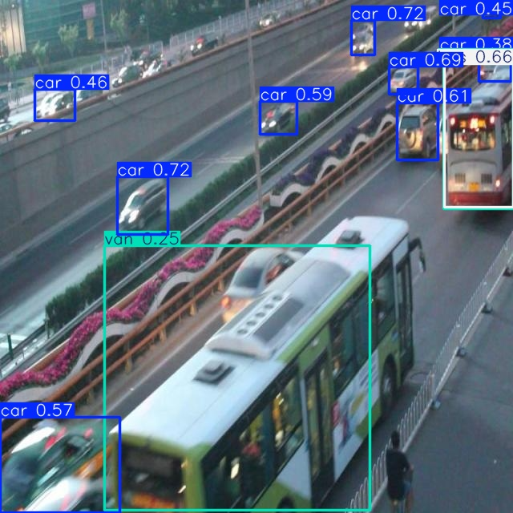

# Báo cáo cá nhân — Ngày 2 Object Detection

## 1. Thông tin học viên

- Họ tên:Trần Duy Đan
- MSSV:2A202603032
- Email:26ai.dantd@vinuni.edu.vn
- Lớp:L2A
- Link repo bài làm:https://github.com/cules2004/K5-L2A-Day02-TranDuyDan-2A202603032-ObjectDetection.git
- Link Colab đã chạy:https://colab.research.google.com/github/cules2004/K5-L2A-Day02-TranDuyDan-2A202603032-ObjectDetection/blob/main/notebooks/day2_annotation_to_yolo.ipynb#scrollTo=H8WMkp5oew9V

## 2. Schema và mini guideline

Dẫn tới [GUIDELINE_MINI.md](../../GUIDELINE_MINI.md). Tóm tắt ba ca mơ hồ đã quyết định, cách áp dụng schema và phần cần giảng viên làm rõ.

## 3. Annotation và self-QC

- Số file nhãn train:50
- Kết quả checker và lỗi đã xử lý:ĐẠT cấu trúc: 50/50 file nhãn hợp lệ. Chờ ground truth để chấm chất lượng.
- Danh sách ít nhất 10 ảnh đã rà bằng mắt:
    driver_004.jpg
    driver_005.jpg
    driver_006.jpg
    driver_007.jpg
    driver_008.jpg
    driver_009.jpg
    driver_0010.jpg
    driver_0011.jpg
    driver_0012.jpg
    driver_0013.jpg
    driver_0014.jpg    
- Lỗi bỏ sót/box/class phát hiện khi rà và cách sửa: Không phát hiện
- Commit khóa nhãn ban đầu: 4fa6aa1 (HEAD -> main, origin/main, origin/HEAD) Update annotations and evaluation results
7776c23 Add files via upload
0173b33 Create student Day02 Object Detection lab with standardized documentation

## 4. Gold QC và rework

| Chỉ số | Trước sửa | Sau sửa nếu có |
|---|---:|---:|
| TP | 447 | 640 |
| FP | 525 | 41 |
| FN | 206 | 13 |
| Precision | 0.4599 | 0.9398 |
| Recall | 0.6845 | 0.9801 |
| F1 | 0.5502 | 0.9595 |
| mean_iou_of_matches | 0.8441 | 0.9910 |
| passed | false | true |

[annotation_evaluation.json](../outputs/annotation_evaluation.json).
Không rework

## 5. Kết quả YOLO

- Runtime, GPU/CPU, phiên bản Ultralytics và Torch: Google Colab, Python 3.13.16; sử dụng GPU NVIDIA Tesla T4 (14913 MiB), CUDA:0; Ultralytics 8.4.208; Torch 2.14.1+cu130.
- Các tham số thay đổi so với notebook nếu có và lý do: Không thay đổi 
- Đường dẫn best checkpoint trong phiên chạy: `/content/Day2-Lab/outputs/yolo26_runs/vehicle_annotation/weights/best.pt`.

| Chỉ số trên 10 ảnh eval | Giá trị |
|---|---:|
| Precision | 0.5013 |
| Recall | 0.4122 |
| mAP50 | 0.4773 |
| mAP50–95 | 0.3203 |

[Thư mục ảnh dự đoán trên tập eval](assets/eval_predictions/visuals/)
[Thư mục kết quả YOLO26](assets/yolo26_runs/)

### 1. Lớp nào recall thấp nhất? Ảnh nào minh họa?

Lớp `bus` có recall thấp nhất, bằng 0.000; tiếp theo là `truck` với recall 0.200. Tập eval có 2 đối tượng bus trong 2 ảnh.

### 2. Nếu mAP50 cao nhưng mAP50–95 thấp, cần kiểm điều gì trên box?

Cần kiểm tra độ chính xác vị trí và kích thước box: box có bị lệch, quá rộng, cắt mất một phần xe hoặc chứa nhiều nền hay không. Đặc biệt chú ý xe nhỏ, bị che khuất và bị cắt ở rìa ảnh.

mAP50 đánh giá tại ngưỡng IoU 0.50, còn mAP50–95 lấy trung bình tại các ngưỡng từ 0.50 đến 0.95. Box có thể đạt ngưỡng 0.50 nhưng không đủ sát để đạt các ngưỡng cao hơn. Trong kết quả này, mAP50 là 0.4773 và mAP50–95 là 0.3203; cần xem ảnh để xác định lỗi box cụ thể.

### 3. Lỗi class nào có thể liên quan guideline? Dữ kiện nào hỗ trợ nhận xét?

Các ranh giới lớp cần rà lại trong guideline là `car`–`van`, `van`–`bus` và `van`–`truck`, nhất là với xe chở người thân hộp hoặc xe chở hàng có cabin liền thân.

Kết quả cho thấy recall của `bus` là 0.000 và `truck` là 0.200, thấp hơn `car` (0.872) và `van` (0.577). Tuy nhiên, tập eval chỉ có 2 bus và 5 truck nên chưa đủ cơ sở kết luận guideline gây nhầm lớp.

Để xác nhận, cần đối chiếu ảnh, nhãn thật, lớp dự đoán và confusion matrix; sau đó chỉ ra một xe cụ thể có cách phân lớp chưa rõ hoặc không nhất quán với guideline.

### 4. Vì sao không dùng 10 ảnh eval để train? Vai trò validation của chúng trong notebook là gì?

Không đưa 10 ảnh eval vào dữ liệu train vì cần giữ một tập ảnh riêng để kiểm tra khả năng dự đoán trên dữ liệu không trực tiếp dùng cập nhật trọng số. Nếu dùng chúng để train, kết quả đánh giá có thể lạc quan và không phản ánh đúng khả năng tổng quát hóa.

Với vai trò validation trong notebook, chúng được dùng để theo dõi chất lượng mô hình, tính Precision, Recall, mAP và hỗ trợ chọn checkpoint tốt nhất nếu được cấu hình làm tập val.

Do được dùng trong quá trình chọn mô hình, đây là tập validation, không phải tập test độc lập cuối cùng. Muốn đánh giá cuối cùng khách quan hơn cần một tập test riêng chưa dùng để điều chỉnh hay chọn mô hình.

## 6. Khó khăn và cách xử lý

| Bước/thời điểm | Lỗi quan sát | Cách đã thử | Kết quả/còn thiếu |
|---|---|---|---|
| | | | |

## 7. Tự đánh giá theo rubric

## Tự đánh giá theo rubric

| Tiêu chí | Điểm tối đa | Tự đánh giá |
|---|---:|---|
| Hoàn thành và định dạng YOLO | 10 | Đã chuẩn bị 50 file nhãn train. Cần bổ sung kết quả chạy thành công `check_yolo_labels.py` để xác nhận basename, số cột, tọa độ chuẩn hóa và ID lớp hợp lệ. |
| Đầy đủ vật thể | 20 | Sau sửa, kết quả đối chiếu gold đạt TP = 640, FN = 13 và Recall = 0.9801, cho thấy mức độ bao phủ tốt. Cần đối chiếu trực quan các trường hợp chưa khớp để xác định có bỏ sót vật thể hay không. |
| Độ bám sát và hình học box | 20 | Mean IoU của các cặp khớp đạt 0.9910, cho thấy các box được ghép với gold có độ trùng khớp cao. Chỉ số này chưa phản ánh các box không được ghép; cần kết hợp kiểm tra ảnh để đánh giá đầy đủ. |
| Phân lớp nhất quán | 15 | Đã xây dựng định nghĩa cho bốn lớp `car`, `truck`, `bus`, `van`. Cần bổ sung ví dụ trực quan về các trường hợp dễ nhầm; không kết luận lỗi class chỉ từ FP/FN tổng hợp. |
| Mini guideline và quyết định mơ hồ | 10 | Đã soạn định nghĩa lớp và quy tắc xử lý box, xe bị che, xe cắt khung và xe nhỏ/mơ hồ. Cần bảo đảm bản nộp có ít nhất ba trường hợp mơ hồ kèm quyết định và lý do rõ ràng. |
| Gold-set annotation QC | 15 | Đạt ngưỡng yêu cầu với F1 = 0.9595, mean IoU = 0.9910 và `passed: true`. So với trước sửa, F1 tăng từ 0.5502 lên 0.9595. Cần ghi rõ ảnh đã kiểm tra, quyết định sửa/giữ và lý do trong phần rework. |
| Pipeline YOLO và phân tích | 10 | Đã chạy YOLO26n trên Colab với GPU Tesla T4, đánh giá trên 10 ảnh eval và xuất ảnh dự đoán. Kết quả đạt mAP50 = 0.4773 và mAP50–95 = 0.3203. Cần hoàn thiện liên kết minh chứng, nhận xét vật thể cụ thể và xác nhận giữ đúng split, không dùng eval để train. |

## 8. Công cụ AI và tài liệu tham khảo

CHATGPT 
